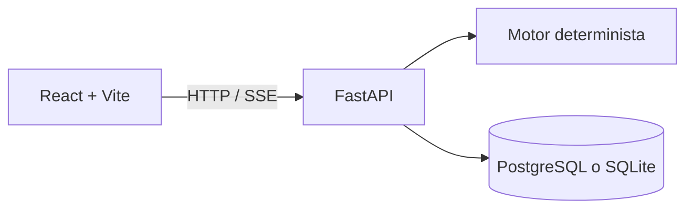

# Interrogatorio

Prototipo de juego de misterio en español con API FastAPI, interfaz React y un motor determinista. El jugador entrevista sospechosos, presenta pruebas, guarda notas y formula una acusación. La verdad se genera en el servidor a partir de una semilla; las respuestas actuales también son deterministas y no consumen servicios de IA.

> **Estado:** experiencia completa para demostración local y portafolio. No debe
> exponerse públicamente sin los controles operativos descritos en “Seguridad y
> límites conocidos”. El motor ofrece tres familias de expedientes con título,
> resumen, cronología y conexiones o contradicciones entre evidencias.

## Inicio con Docker

Requisitos: Docker Desktop con Compose. Desde esta carpeta:

```bash
docker compose up --build
```

Abre http://localhost:8080; API y documentación interactiva en http://localhost:8000/docs. La configuración incluida es exclusivamente para desarrollo local. Para cerrar, usa `docker compose down`. Los datos de PostgreSQL persisten en un volumen.

## Inicio sin Docker

Python 3.12 y Node.js 20+ son necesarios. En una terminal, desde `backend`:

```bash
python -m pip install -r requirements.txt
python -m uvicorn app.main:app --reload
```

En otra, desde `frontend`:

```bash
npm install
npm run dev
```

Abre la dirección que muestra Vite. Por defecto la API usa SQLite local y el frontend llama a `http://localhost:8000`. El inicio de sesión requiere usuario alfanumérico (se permite guion bajo) y contraseña de 8 caracteres o más. También existe modo invitado; conservar el token del navegador permite recuperar sus partidas.

## Pruebas

Desde `backend`: `python -m pytest --cov=app`. Desde `frontend`: `npm run build`. Los tests no hacen llamadas a un modelo externo.

## Arquitectura



El motor construye el caso con una semilla y verifica sus invariantes. La semilla
selecciona una de tres familias narrativas y mantiene reproducibles sospechosos,
cronología, evidencias y culpable. El servidor guarda progreso y notas y devuelve
solo la vista pública. Las respuestas se seleccionan con reglas, no con un LLM:
por ello no hay costes de tokens. SSE entrega la respuesta completa en un único
evento.

## API principal

- `POST /auth/register`, `/auth/login`, `/auth/guest`
- `POST /games`, `GET /games`, `GET /games/{id}`
- `POST /games/{id}/question`, `PUT /games/{id}/notes`
- `POST /games/{id}/accuse`, `GET /ranking`, `GET /health`

Las rutas de partidas requieren el token Bearer. El contrato detallado está en `/docs` cuando la API está en marcha.

## Seguridad y límites conocidos

Las contraseñas usan Argon2 y las entradas tienen límites básicos. El proyecto **no debe exponerse públicamente**: falta rate limiting, protección contra intentos de acceso, rotación y revocación de tokens, moderación y control de concurrencia. En desarrollo, si no se configura `JWT_SECRET` con al menos 32 caracteres, se genera una clave temporal y las sesiones dejan de funcionar al reiniciar. Para conservarlas, configura una clave aleatoria larga en `.env` (Compose) o como variable de entorno (ejecución directa). Con `APP_ENV=production`, el servidor rechaza claves ausentes, cortas o la antigua clave de ejemplo; esto no significa que el prototipo esté listo para producción. `/health` comprueba que el proceso responde y `/ready` verifica además la conexión a la base de datos. La semilla y las pistas permiten reconstruir o inferir la solución, de modo que no son secretos resistentes a un jugador con acceso al código. Las pruebas de ataques verifican únicamente respuestas deterministas, no seguridad frente a un modelo real.

## Material para portafolio

La interfaz y el flujo local fueron verificados en escritorio y a 390 px:
creación de sesión invitada, apertura de expediente, cronología, conexiones de
evidencias, pregunta y respuesta. No se ha desplegado esta versión. Antes de
publicarla, configura claves y orígenes seguros, rate limiting, supervisión y una
base PostgreSQL dedicada, y repite el flujo contra la URL resultante.
