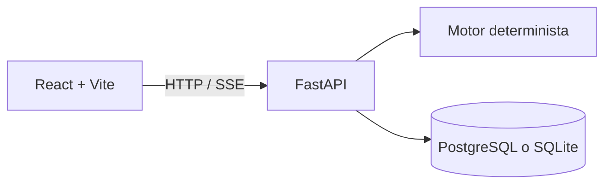

# Interrogatorio

Prototipo de juego de misterio en español con API FastAPI, interfaz React y un motor determinista. El jugador entrevista sospechosos, presenta pruebas, guarda notas y formula una acusación. La verdad se genera en el servidor a partir de una semilla; las respuestas actuales también son deterministas y no consumen servicios de IA.

> **Estado:** publicado en Azure Container Apps como demo pública
> (<https://interrogatorio-gervasio-std.purpleocean-4aad06ee.chilecentral.azurecontainerapps.io/>).
> El motor ofrece tres familias de expedientes con título, resumen, cronología
> y conexiones o contradicciones entre evidencias.

## Inicio con Docker

Requisitos: Docker Desktop con Compose. Desde esta carpeta:

```bash
docker compose up --build
```

Abre http://localhost:8080; API y documentación interactiva en http://localhost:8000/docs. La configuración incluida es exclusivamente para desarrollo local. Para cerrar, usa `docker compose down`. Los datos de PostgreSQL persisten en un volumen.

## Inicio sin Docker

Python 3.12 y Node.js 20+ son necesarios. En una terminal, desde `backend`:

```bash
python -m pip install -r requirements.txt
python -m uvicorn app.main:app --reload
```

En otra, desde `frontend`:

```bash
npm install
npm run dev
```

Abre la dirección que muestra Vite. Por defecto la API usa SQLite local y el frontend llama a `http://localhost:8000`. El inicio de sesión requiere usuario alfanumérico (se permite guion bajo) y contraseña de 8 caracteres o más. También existe modo invitado; conservar el token del navegador permite recuperar sus partidas.

## Pruebas

Desde `backend`: `python -m pytest --cov=app`. Desde `frontend`: `npm run build`. Los tests no hacen llamadas a un modelo externo.

## Arquitectura



El motor construye el caso con una semilla y verifica sus invariantes. La semilla
selecciona una de tres familias narrativas y mantiene reproducibles sospechosos,
cronología, evidencias y culpable. El servidor guarda progreso y notas y devuelve
solo la vista pública. Las respuestas se seleccionan con reglas, no con un LLM:
por ello no hay costes de tokens. SSE entrega la respuesta completa en un único
evento.

## API principal

- `POST /auth/register`, `/auth/login`, `/auth/guest`
- `POST /games`, `GET /games`, `GET /games/{id}`
- `POST /games/{id}/question`, `PUT /games/{id}/notes`
- `POST /games/{id}/accuse`, `GET /ranking`, `GET /health`

Las rutas de partidas requieren el token Bearer. El contrato detallado está en `/docs` cuando la API está en marcha.

## Seguridad y límites conocidos

- Contraseñas con Argon2 y límites de tamaño en todas las entradas.
- **Límite de peticiones por IP** (`app/limites.py`): registro 5/min, inicio
  de sesión 10/min, invitados 20/min, creación de partidas 120/min y 600
  peticiones/min en total. Responde `429` con `Retry-After`. Se desactiva con
  `RATE_LIMIT=off` (solo para pruebas).
- Cabeceras `X-Content-Type-Options`, `X-Frame-Options` y `Referrer-Policy`.
- Con `APP_ENV=production`, el servidor exige `JWT_SECRET` aleatorio de 32+
  caracteres. Las sesiones duran 12 horas.
- `/health` comprueba el proceso y `/ready` además la base de datos.

Límites conocidos: el limitador vive en memoria (vale para una réplica; con
varias habría que usar Redis) y no hay revocación de tokens antes de su
vencimiento. La semilla y las pistas permiten reconstruir la solución a quien
lea el código: es un juego, no un secreto.

## Producción (un solo contenedor)

`Dockerfile` en esta carpeta compila la interfaz y la sirve desde FastAPI en el
puerto 8000, con la API en el mismo dominio. Variables:

| Variable       | Uso                                                        |
| -------------- | ---------------------------------------------------------- |
| `APP_ENV`      | `production`                                               |
| `JWT_SECRET`   | Secreto aleatorio de 32+ caracteres (secreto de Azure)     |
| `DATABASE_URL` | Por defecto SQLite en `/data`; acepta PostgreSQL           |
| `CORS_ORIGINS` | Solo si otra web llama a la API                            |

```bash
docker build -t interrogatorio . && docker run -p 8000:8000 \
  -e APP_ENV=production -e JWT_SECRET=$(openssl rand -base64 48) interrogatorio
```

El flujo `.github/workflows/interrogatorio.yml` prueba y, en `main`, publica la
imagen y actualiza la Container App `interrogatorio-gervasio-std`.

## Material para portafolio

La interfaz y el flujo local fueron verificados en escritorio y a 390 px:
creación de sesión invitada, apertura de expediente, cronología, conexiones de
evidencias, pregunta y respuesta. La versión publicada se verifica con el mismo
flujo contra la URL de Azure.
