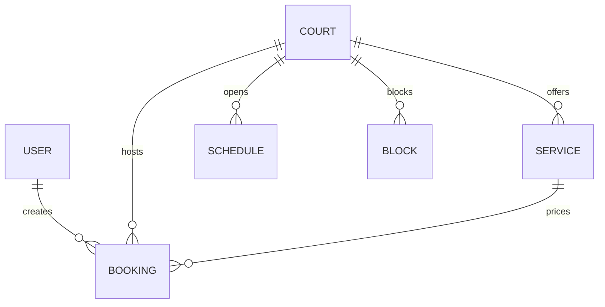

# Diseño de ReservaYa

El centro deportivo ficticio de Rancagua ofrece turnos de una hora para fútbol, pádel y tenis. La página busca reducir la coordinación manual: clientes y personal consultan la misma disponibilidad, y administración puede separar las reservas confirmadas de las canceladas por fecha y cancha.

| Persona | Historia | Criterio verificable |
|---|---|---|
| Cliente | Quiero encontrar una cancha disponible para jugar a la hora que necesito. | Filtrar deportes, elegir cancha y fecha, ver turnos libres y ocupados. |
| Cliente | Quiero confirmar o cancelar una reserva. | Se registra la reserva, aparece en mi historial y puedo cancelar antes del inicio. |
| Administrador | Quiero administrar los servicios y la disponibilidad. | Puedo cambiar días, horas, precios y bloquear una franja sin afectar el historial. |
| Centro deportivo | Quiero evitar reservas duplicadas. | Dos solicitudes simultáneas sobre la misma cancha y hora producen una confirmación y un conflicto. |

- `Court` representa el recurso físico. Varios servicios o tarifas pueden compartir la cancha.
- `Schedule` almacena la disponibilidad recurrente por día y hora local. `Block` almacena excepciones puntuales.
- `Booking` guarda el precio de la transacción, el inicio UTC y el estado. Un índice único parcial sobre `(court_id, starts_at)` impide dos confirmaciones, incluso si son servicios distintos. La cancelación cambia el estado y libera el turno conservando el historial.
- Las operaciones de reserva, bloqueo y administración de horarios adquieren un bloqueo de fila sobre la cancha en la transacción. La comprobación de bloqueos y la inserción se ejecutan después de adquirirlo. Se devuelve HTTP 409 si un conflicto impide confirmar.
- La zona lógica es `America/Santiago`. Las horas se convierten con `zoneinfo`; el calendario usa la misma zona. Se reserva con hasta 60 días de anticipación.
- Se usa Argon2 para contraseñas. El JWT vence en 4 horas y viaja por cookie HttpOnly y SameSite Strict, con Secure en producción. El rol se consulta en BD y se comprueba en los endpoints administrativos. La API y el frontend se sirven juntos para mantener un solo origen.

## Rutas web

- `/`: catálogo y filtros por deporte.
- `/cancha/:id`: calendario, selección de hora y reserva.
- `/reservas`: historial y cancelación.
- `/ingresar`: sesión y registro.
- `/admin`: calendario, servicios, horarios y bloqueos.

## Estructura y fases

`backend/app` contiene la API, modelos, autenticación y semilla. `backend/alembic` contiene las migraciones y `backend/tests` las pruebas de API. `frontend/src` contiene rutas, componentes y pruebas.

| Fase | Entrega | Commit sugerido |
|---|---|---|
| 1 | Dominio, historias, modelo y rutas | `docs: design court booking flows` |
| 2 | Sesión, catálogo, reserva y administración | `feat: implement court booking API` |
| 3 | Integración PostgreSQL y concurrencia | `test: cover booking and race conditions` |
| 4 | Cliente web y panel de administración | `feat: build booking and admin views` |
| 5 | Selector y flujo de confirmación | `test: cover customer booking flow` |
| 6 | Docker Compose y comprobaciones en CI | `build: add containers and CI` |
| 7 | README y arquitectura | `docs: explain local development and architecture` |
| 8 | Guía Docker y variables de despliegue | `docs: add container deployment guide` |
