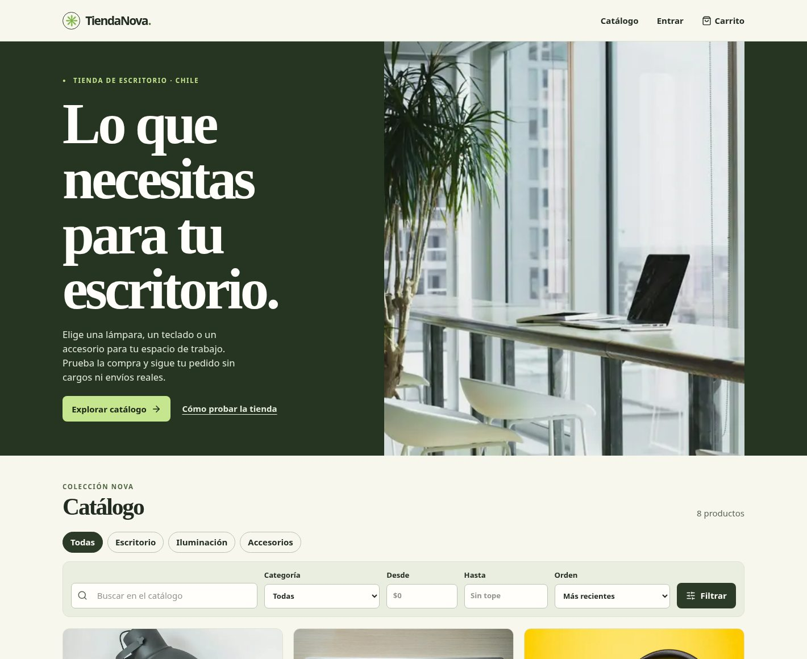

# TiendaNova

Tienda de demostración para productos de escritorio. El catálogo se genera en el servidor. Los clientes pueden buscar artículos, guardar su carrito, registrar una dirección y hacer una compra simulada. El panel admin controla catálogo, stock, estados de entrega y ventas.

| Capa                   | Tecnología                                           |
| ---------------------- | ---------------------------------------------------- |
| Aplicación             | Next.js App Router, React, TypeScript y Tailwind CSS |
| Identidad y validación | Auth.js, bcrypt, Zod                                 |
| Datos                  | PostgreSQL y Prisma                                  |
| Verificación           | ESLint, TypeScript, Vitest y Playwright              |



[Ver guía de demostración](docs/screenshots/recorrido.jpg)

## Ejecutar en el PC

Requiere Docker con el complemento Compose o Node 24, npm y PostgreSQL 16 o superior.

### Docker Compose

1. Copia `.env.example` a `.env`.
2. Genera un secreto con `node -e "console.log(require('node:crypto').randomBytes(48).toString('base64url'))"` o un generador equivalente. Asigna el resultado a `AUTH_SECRET`.
3. Para usar el panel admin, configura opcionalmente `SEED_ADMIN_EMAIL` y `SEED_ADMIN_PASSWORD` con valores de prueba propios.
4. Ejecuta `docker compose up --build`.
5. Abre <http://localhost:3000>. PostgreSQL se abre en el puerto local 5435.

Compose inicializa la base, aplica la migración, agrega un catálogo ficticio y luego inicia la aplicación. No crea cuentas administrativas salvo que se configuren las variables del paso 3. El volumen conserva datos entre ejecuciones. Usa `docker compose down` para detenerlo.

### Node y PostgreSQL existentes

1. Crea una base PostgreSQL vacía para la aplicación.
2. Configura `DATABASE_URL`, `DIRECT_URL` y `AUTH_SECRET` en `.env`.
3. Ejecuta desde la carpeta `tiendanova`:

```sh
npm ci
npx prisma generate
npm run db:migrate
npm run db:seed
npm run dev
```

## Pruebas

Usa una base dedicada con nombre que termine en `_test`. Exporta su conexión como `DATABASE_URL` y `DIRECT_URL`, y genera un `AUTH_SECRET` de pruebas. Si la aplicación ya ocupa el puerto 3000, ciérrala antes del E2E.

```sh
npm run db:migrate
npm run db:seed
npm run lint
npm run typecheck
npm test
npm run build
npx playwright install chromium
npm run test:e2e
```

El test de integración intenta vender simultáneamente una última unidad y verifica qué queda en la base. El test E2E aplica una búsqueda, persiste el carrito de invitado, registra al cliente, importa el carrito, simula rechazo y aprobación, comprueba el pedido y verifica que el cliente no accede al panel admin. Con un administrador sembrado, también avanza el pedido a enviado y entregado y comprueba los cambios desde el seguimiento del cliente. Los umbrales de cobertura del 70 % se aplican a validación, almacenamiento de carrito y lógica de compra. El test de stock se omite si no se configura una base terminada en `_test`, por lo que la cobertura completa requiere PostgreSQL.

El reporte de cobertura queda en `coverage/index.html`. Si ya tienes Chromium instalado, puedes indicarlo con `CHROMIUM_PATH`. Para una app de pruebas existente define `BASE_URL`. Las pruebas crean pedidos y usuarios ficticios en la base de pruebas.

## Despliegue en Vercel

1. Sube el código a tu repositorio personal. Si compartes un repositorio con otros proyectos, importa el repositorio en Vercel con directorio raíz `tiendanova`.
2. Usa una base PostgreSQL gestionada que ya tengas autorizada. Crea una base o rama específica para esta demo. Usa la cadena con pool si tu proveedor la ofrece para `DATABASE_URL` y la cadena de conexión directa para `DIRECT_URL`.
3. Antes de abrir la aplicación, aplica el schema y el catálogo en esa base desde una terminal de confianza: `npm run db:migrate` y `npm run db:seed`. Si la base solo admite conectividad IPv6 o tiene restricciones de red, usa el modo de conexión de migraciones documentado por tu proveedor. Nunca subas `.env`.
4. En Vercel configura `DATABASE_URL`, `DIRECT_URL`, `AUTH_SECRET` y `AUTH_TRUST_HOST=true` en los entornos que usarás. Mantén previews separadas de la base pública.
5. Selecciona Next.js y Node 24. El proyecto trae el comando de compilación. En una cuenta personal con un plan gratuito compatible, verifica los límites del plan de Vercel y del proveedor de PostgreSQL antes de crear recursos.
6. Publica y abre `/health` en la URL asignada. Comprueba en ventana privada el catálogo y una compra con datos ficticios. Conserva un secreto de sesión distinto para cada entorno.

Vercel: <https://vercel.com/docs/deployments> · PostgreSQL: <https://www.postgresql.org/docs/> · Auth.js: <https://authjs.dev/>.

## Decisiones para explicar en una entrevista

- **Rutas de servidor**. El listado y la ficha salen como HTML. El JS del carrito se usa para interacciones y almacenamiento del visitante.
- **Stock transaccional**. Ante una carrera, PostgreSQL solo aplica el descuento si aún hay unidades. Stock, pedido y carrito se actualizan juntos.
- **Autenticación sin proveedores externos**. Auth.js mantiene sesiones JWT y las contraseñas son hashes bcrypt. Las acciones comprueban identidad y roles en el servidor.
- **Pedidos históricos**. El precio y la dirección quedan como instantáneas al comprar. El administrador archiva productos para preservar su historial.
- **Datos y pagos de demostración**. Los montos se expresan en CLP. No se piden tarjetas ni se envían correos reales. Una integración futura podría agregar un proveedor de pagos con webhooks e idempotencia, verificación de correo, límites de solicitudes y un sistema real de despacho.

Más detalles en [arquitectura, historias y rutas](docs/arquitectura.md). Fotos ilustrativas de Unsplash: [licencia](https://unsplash.com/license) y [fuentes de imágenes](docs/imagenes.md).

Mensajes de commit propuestos por fase: `docs: define historias y arquitectura`, `feat: implementa cuentas, catálogo y compra`, `test: verifica concurrencia y navegación`, `ci: agrega compilación y pruebas`, `docs: documenta ejecución y despliegue`.

## Cancelación simulada

El titular puede cancelar un pedido pagado antes del despacho. La operación cambia el estado y restituye las unidades en una sola transacción; los reintentos simultáneos no duplican el stock. Una cancelación en carrera con el despacho solo puede ganar si el pedido sigue pagado. Los pedidos cancelados quedan en el historial y se excluyen de las ventas simuladas. No hay cobros ni reembolsos reales. Aplicar las migraciones antes de iniciar la versión nueva.
