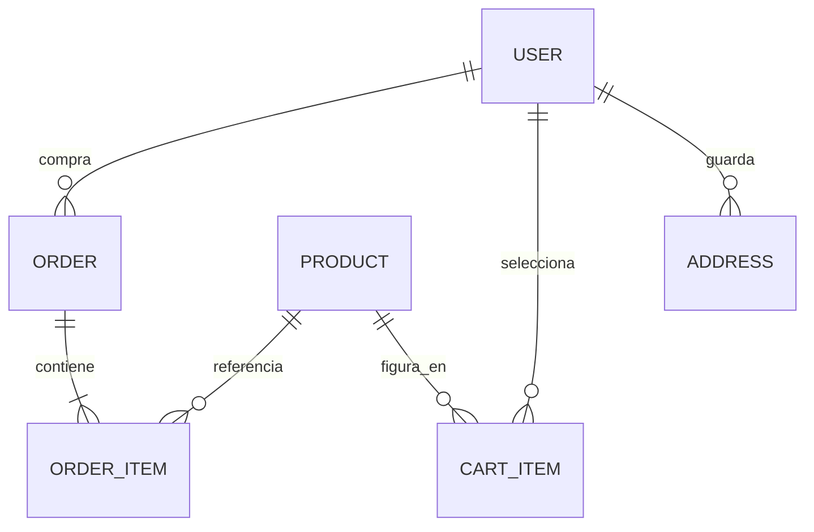

# Arquitectura de TiendaNova

## Alcance y actores

- Visitante: busca en un catálogo de accesorios de escritorio, filtra, cambia de página y guarda una selección en su navegador.
- Cliente: crea una cuenta con credenciales, mantiene un carrito en PostgreSQL, importa su selección local, guarda direcciones y consulta sus pedidos.
- Administrador: publica, actualiza o archiva productos, controla inventario, avanza estados de entrega y revisa ventas de prueba.

### Historias y criterios

| Historia                        | Criterio de aceptación                                                                                                     |
| ------------------------------- | -------------------------------------------------------------------------------------------------------------------------- |
| Buscar una pieza de escritorio  | El HTML del servidor contiene los productos de la página y aplica búsqueda, rango de precio, categoría y orden.            |
| Continuar una compra            | Una recarga mantiene el carrito. El visitante autenticado puede importar la selección local.                               |
| Pagar un pedido de prueba       | El carrito de cuenta requiere una dirección propia. Una aprobación produce un pedido. Un rechazo conserva carrito y stock. |
| Comprar la última unidad        | Si dos usuarios intentan comprarla al mismo tiempo, solo uno consigue el pedido.                                           |
| Revisar pedidos                 | Cada cliente ve únicamente sus propios pedidos y el estado actual.                                                         |
| Administrar catálogo y entregas | Los controles requieren rol ADMIN. Se conserva el historial al archivar un producto.                                       |

## Datos

Los precios y totales son enteros CLP. Cada pedido guarda el nombre, precio y dirección del momento de compra. El identificador de idempotencia es único por usuario. El esquema PostgreSQL impone stock no negativo, cantidades válidas y claves foráneas.

## Rutas

| Ruta                              | Método              | Alcance                                                             |
| --------------------------------- | ------------------- | ------------------------------------------------------------------- |
| `/`                               | GET                 | Catálogo SSR. Query: `q`, `category`, `min`, `max`, `sort`, `page`. |
| `/catalogo/[slug]`                | GET                 | Página y galería de un producto activo, con metadata propia.        |
| `/entrar`, `/registro`            | GET / acciones POST | Cuenta por correo y contraseña.                                     |
| `/carrito`                        | GET / acciones POST | Cantidades, importación de invitado, checkout simulado.             |
| `/cuenta`, `/cuenta/pedidos/[id]` | GET / acciones POST | Historial propio y direcciones.                                     |
| `/admin`                          | GET / acciones POST | Catálogo, pedidos y métricas para administradores.                  |
| `/api/auth/[...nextauth]`         | GET / POST          | Sesiones y autenticación con Auth.js.                               |
| `/api/products/[id]/availability` | GET                 | Stock visible de una ficha, actualizado cada 20 segundos.           |
| `/health`                         | GET                 | Comprobación de PostgreSQL sin detalles de la conexión.             |

Las operaciones de escritura son acciones del servidor de Next.js. Las llamadas revalidan identidad y rol. No se trata el estado del navegador como autoridad para pagos, cantidades o precios.

## Flujo de compra

1. Validar petición, usuario, dirección y clave de idempotencia.
2. Dentro de la transacción, bloquear el carrito de esa cuenta, buscar un pedido previo y volver a leer sus líneas.
3. Descontar stock con una condición `stock >= quantity`. Los productos se bloquean en el mismo orden para reducir interbloqueos.
4. Guardar pedido, sus líneas y la copia de la dirección, y vaciar el carrito. Si una línea no tiene stock, se revierte todo.
5. Emitir un evento de confirmación de demo que guarda el ID del pedido en el registro de la aplicación. No se conecta a un proveedor de pagos o correo.

## Estructura

- `src/app/`: páginas, acciones servidor, estilos y rutas técnicas.
- `src/components/`: galería, formularios, carrito de invitado y gráfico.
- `src/lib/`: validación, sesión, catálogo y servicio de compra.
- `prisma/`: modelo, migración SQL e inicialización idempotente.
- `tests/`: unidades, integración con PostgreSQL y navegación E2E.
- `.github/workflows/ci.yml`: verificación al actualizar el repositorio.
